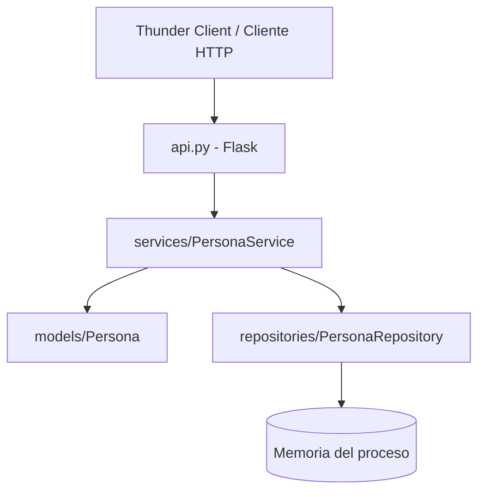

# CRUD de Personas con Flask

Trabajo práctico: CRUD de personas aplicando la separación entre modelo,
repositorio, servicio y API. Esta entrega implementa únicamente los dos GET y
el POST solicitados.

## Requisitos

- Python 3.10 o superior.
- Flask, instalado con `pip install -r requirements.txt`.

## Estructura del proyecto

```text
persona-crud/
├── api.py
├── models/
│   ├── __init__.py
│   └── persona.py
├── repositories/
│   ├── __init__.py
│   └── persona_repository.py
├── services/
│   ├── __init__.py
│   └── persona_service.py
├── tests/
│   └── test_api.py
├── thunder-client/
│   └── personas-requests.json
├── README.md
└── requirements.txt
```



## Responsabilidades y criterios

- **Modelo (`models/persona.py`)**: representa a la persona y valida los datos
  para que siempre mantenga sus reglas. El DNI y el nombre son obligatorios.
  El nombre tiene hasta 30 caracteres, empieza con mayúscula y continúa con
  minúsculas (se permiten espacios entre palabras, pero todas las letras
  posteriores a la inicial deben ser minúsculas).
- **Repositorio (`repositories/persona_repository.py`)**: concentra las
  operaciones de persistencia. Para este ejemplo usa un diccionario en memoria;
  los datos se pierden al detener el servidor.
- **Servicio (`services/persona_service.py`)**: coordina el modelo y el
  repositorio. Evita registrar un DNI duplicado.
- **API (`api.py`)**: traduce las solicitudes HTTP en llamadas al servicio y
  devuelve JSON con códigos HTTP apropiados.

El modelo no conoce ni accede al repositorio. Las reglas propias de una persona
están en el modelo y la regla que depende de consultar otras personas (DNI
único) está en el servicio.

## Instalación y ejecución

Desde la carpeta del proyecto, en PowerShell:

```powershell
py -m venv .venv
.\.venv\Scripts\Activate.ps1
py -m pip install -r requirements.txt
py api.py
```

La API queda disponible en `http://127.0.0.1:5000`.

## Endpoints implementados

| Método | Ruta | Resultado |
| --- | --- | --- |
| GET | `/personas` | Lista todas las personas (200). |
| GET | `/personas/{dni}` | Busca una persona (200) o devuelve 404. |
| POST | `/personas` | Crea una persona (201), devuelve 400 si los datos no son válidos o 409 si el DNI ya existe. |

Ejemplo de POST (JSON):

```json
{
  "dni": "30123456",
  "nombre": "Javier"
}
```

## Prueba con Thunder Client

1. Inicia el servidor con `py api.py`.
2. En VS Code, abre Thunder Client y selecciona **Import**.
3. Importa `thunder-client/personas-requests.json`.
4. Envía **Crear persona válida** y luego prueba **Listar personas**,
   **Buscar persona existente**, **Crear DNI duplicado** y
   **Buscar DNI inexistente**.
5. La colección también incluye un caso de nombre inválido para verificar la
   respuesta de validación.

La colección usa `http://127.0.0.1:5000` y el DNI `30123456`.

## Pruebas automatizadas

Con Flask instalado, ejecuta:

```powershell
py -m unittest discover -s tests -v
```
